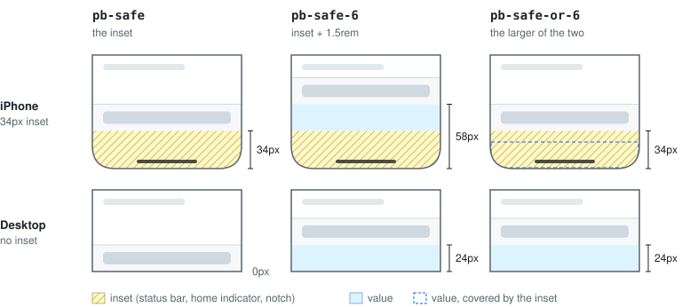
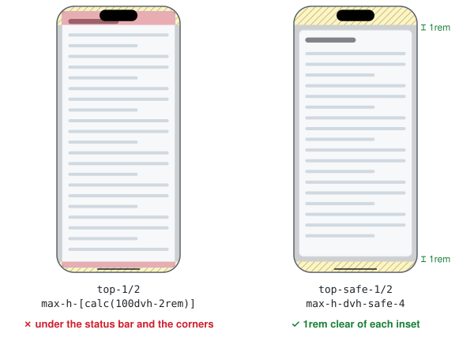
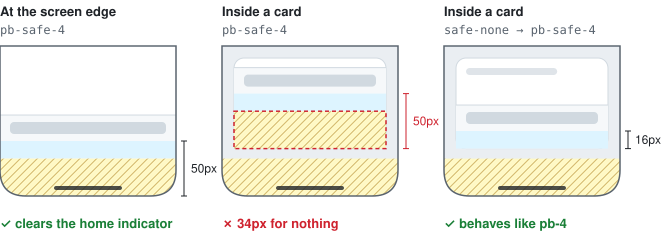

# tailwind-safe-insets

Tailwind CSS v4 utilities that keep your content clear of the notch, the status bar and the home indicator, with the value syntax you already know.

```html
<header class="sticky top-0 pt-safe-4 px-safe-4">…</header>
<nav class="fixed inset-x-0 bottom-0 pb-safe-or-2">…</nav>
<button class="fixed right-safe-4 bottom-safe-or-4">+</button>
```

## Summary

1. [Quick start](#quick-start)
2. [One rule: plus, or at least](#one-rule-plus-or-at-least)
3. [Recipes](#recipes)
   1. [Sticky header](#sticky-header)
   2. [Bottom tab bar](#bottom-tab-bar)
   3. [Floating button](#floating-button)
   4. [Page gutters](#page-gutters)
   5. [Modal](#modal)
   6. [Full-height panel](#full-height-panel)
   7. [Edge-to-edge image](#edge-to-edge-image)
   8. [Anchor links under a sticky header](#anchor-links-under-a-sticky-header)
   9. [A component away from the edge](#a-component-away-from-the-edge)
4. [Reference](#reference)
   1. [Utilities](#utilities)
   2. [Viewport sizes](#viewport-sizes)
   3. [Fractions](#fractions)
   4. [Accepted values](#accepted-values)
   5. [Right-to-left layouts](#right-to-left-layouts)
   6. [Opting out and custom insets](#opting-out-and-custom-insets)
   7. [tailwind-merge](#tailwind-merge)
5. [For AI coding assistants](#for-ai-coding-assistants)
6. [Comparison with other packages](#comparison-with-other-packages)
7. [Tailwind core](#tailwind-core)
8. [Development](#development)
9. [License](#license)

## Quick start

1. Install the package:

   ```bash
   npm install tailwind-safe-insets
   ```

2. Import it after Tailwind:

   ```css
   @import "tailwindcss";
   @import "tailwind-safe-insets";
   ```

3. Let the page extend under the device chrome. Without `viewport-fit=cover`, browsers report every inset as 0 and the utilities change nothing:

   ```html
   <meta name="viewport" content="width=device-width, initial-scale=1, viewport-fit=cover" />
   ```

If you merge classes with `cn()` or `twMerge`, also add the [tailwind-merge helper](#tailwind-merge).

## One rule: plus, or at least

Every utility comes in three forms:

<picture>
  <source media="(prefers-color-scheme: dark)" srcset="docs/figures/forms.dark.svg">
  
</picture>

- **`pb-safe-6`** adds the value to the inset. Use it when content needs its usual spacing on top of the device chrome: headers, page gutters, text.
- **`pb-safe-or-6`** takes whichever is larger. Use it when the inset already gives enough room: tab bars, floating buttons, sticky footers.
- **`pb-safe`** is the inset alone.

The value is anything Tailwind accepts: `pb-safe-4`, `pb-safe-1.5`, `pb-safe-sm` (a theme token), `pb-safe-[20px]`.

## Recipes

### Sticky header

The background extends under the status bar, and the content starts below it:

```html
<header class="sticky top-0 pt-safe-4 px-safe-4">…</header>
```

### Bottom tab bar

On an iPhone, the home indicator inset is enough. Elsewhere, keep at least 0.5rem:

```html
<nav class="fixed inset-x-0 bottom-0 px-safe pb-safe-or-2">…</nav>
```

### Floating button

At least 1rem from the bottom, and 1rem from the right edge plus the notch in landscape:

```html
<button class="fixed right-safe-4 bottom-safe-or-4">+</button>
```

### Page gutters

In landscape, the notch side gets the extra room:

```html
<main class="px-safe-4 pb-safe-6">…</main>
```

### Modal

`top-1/2` centers in the viewport, so a tall modal reaches the status bar. `top-safe-1/2` centers between the insets, and `max-h-dvh-safe-4` keeps 1rem clear of each one:

<picture>
  <source media="(prefers-color-scheme: dark)" srcset="docs/figures/modal.dark.svg">
  
</picture>

```html
<div class="fixed top-safe-1/2 left-safe-1/2 -translate-x-1/2 -translate-y-1/2
            w-dvw-safe-4 max-w-lg max-h-dvh-safe-4 sm:max-h-dvh-safe-8 overflow-y-auto">…</div>
```

### Full-height panel

A panel between the status bar and the home indicator:

```html
<aside class="fixed top-safe inset-x-0 h-dvh-safe overflow-y-auto">…</aside>
```

### Edge-to-edge image

Inside a padded article, the negative margin cancels the padding:

```html
<article class="px-safe-4">
  <figure class="-mx-safe-4"></figure>
</article>
```

### Anchor links under a sticky header

The header's height includes the top inset, so the scroll offset must too:

```html
<html class="scroll-pt-safe-16">
  <body>
    <header class="sticky top-0 h-16 box-content pt-safe">…</header>
    <h2 id="pricing">…</h2>  <!-- #pricing lands right below the header -->
  </body>
</html>
```

### A component away from the edge

A footer with `pb-safe-4` is right at the bottom of a page, but adds 34px for nothing inside a card or a drawer. `safe-none` zeroes the insets for an element and everything inside it:

<picture>
  <source media="(prefers-color-scheme: dark)" srcset="docs/figures/opt-out.dark.svg">
  
</picture>

```html
<aside class="drawer safe-none">
  <footer class="pb-safe-4">…</footer>  <!-- behaves like pb-4 here -->
</aside>
```

## Reference

### Utilities

| Padding | Margin | Position   | Scroll padding | Scroll margin | Sides                                    |
| ------- | ------ | ---------- | -------------- | ------------- | ---------------------------------------- |
| `p-`    | `m-`   | `inset-`   | `scroll-p-`    | `scroll-m-`   | all                                      |
| `px-`   | `mx-`  | `inset-x-` | `scroll-px-`   | `scroll-mx-`  | left and right                           |
| `py-`   | `my-`  | `inset-y-` | `scroll-py-`   | `scroll-my-`  | top and bottom                           |
| `ps-`   | `ms-`  | `inset-s-` | `scroll-ps-`   | `scroll-ms-`  | inline start (left in LTR, right in RTL) |
| `pe-`   | `me-`  | `inset-e-` | `scroll-pe-`   | `scroll-me-`  | inline end (right in LTR, left in RTL)   |
| `pt-`   | `mt-`  | `top-`     | `scroll-pt-`   | `scroll-mt-`  | top                                      |
| `pr-`   | `mr-`  | `right-`   | `scroll-pr-`   | `scroll-mr-`  | right                                    |
| `pb-`   | `mb-`  | `bottom-`  | `scroll-pb-`   | `scroll-mb-`  | bottom                                   |
| `pl-`   | `ml-`  | `left-`    | `scroll-pl-`   | `scroll-ml-`  | left                                     |

- Each prefix takes the three forms: `pt-safe`, `pt-safe-{value}` and `pt-safe-or-{value}`.
- Negative margins take them too: `-mx-safe`, `-mx-safe-4`, `-mx-safe-or-4`.
- The position utilities follow Tailwind 4.2+ naming (`inset-s-safe`, `inset-e-safe`, rather than `start-*` and `end-*`), and work with every Tailwind 4 version.
- Each utility writes the same CSS property as its Tailwind counterpart, so it sorts and overrides the same way: `p-safe-4 px-0` behaves like `p-4 px-0`.

### Viewport sizes

These utilities subtract the insets from the dynamic viewport. They take the three forms, and the value applies **on each side**, as with `py-safe-4`:

| Class                 | `max-height`                                                                 |
| --------------------- | ---------------------------------------------------------------------------- |
| `max-h-dvh-safe`      | `100dvh` minus the top and bottom insets                                     |
| `max-h-dvh-safe-4`    | `100dvh` minus (top inset + 1rem) and (bottom inset + 1rem)                  |
| `max-h-dvh-safe-or-4` | `100dvh` minus the larger of the top inset and 1rem, and the same at the bottom |

- **Heights:** `h-dvh-safe`, `min-h-dvh-safe` and `max-h-dvh-safe` subtract the top and bottom insets.
- **Widths:** `w-dvw-safe` and `max-w-dvw-safe` subtract the left and right insets. There is no `min-w-dvw-safe`.
- **Theme tokens:** these utilities read `--spacing-*` tokens only. Core `max-w-lg` reads `--container-lg` (32rem), but here the value is a gap subtracted on each side, not a size, so `max-w-dvw-safe-lg` generates nothing unless you define `--spacing-lg`.
- **Scrollbars:** `100dvw`, like `100vw`, includes a classic desktop scrollbar, so `w-dvw-safe-4` is slightly too wide on a page that scrolls. When that matters, size with insets instead: `fixed inset-x-safe-4 mx-auto max-w-lg` fills the space between the insets, up to `max-w-lg`.

### Fractions

`top`, `right`, `bottom` and `left` take a fraction, which means a fraction **of the safe area**, measured from its edge:

| Class           | CSS                                                    |
| --------------- | ------------------------------------------------------ |
| `top-safe-1/2`  | `top: calc(<top> + (100% - <top> - <bottom>) * 1/2)`   |
| `left-safe-1/2` | `left: calc(<left> + (100% - <left> - <right>) * 1/2)` |

Here `<top>`, `<bottom>`, `<left>` and `<right>` stand for the insets.

- **Meaning:** a fraction does not mean *inset plus value*, since inset + 50% is never the middle. `top-safe-[50%]` keeps that meaning.
- **No brackets:** write fractions bare. A fraction in brackets (`top-safe-[1/2]`) is read as an arbitrary value and produces invalid CSS.
- **Scope:** only the four physical sides take fractions, and not in the `-or-` form. Centering pairs with a translate, which is physical, so there is no `inset-s-safe-1/2`.
- **Containing block:** `100%` is the size of the containing block, while the insets are those of the screen.
  - The result is right for a `fixed` element, or an `absolute` one whose containing block covers the screen.
  - A `fixed` element is positioned against an ancestor instead when that ancestor has `transform`, `translate`, `scale` or `rotate` (Tailwind's `translate-*`, `scale-*` and `rotate-*` set these, even at `translate-x-0` or `scale-100`), `filter`, `backdrop-filter`, `perspective`, `contain: layout` or `contain: paint`, or `will-change` naming one of them.
- **Height cap:** pair a fraction with the additive cap (`max-h-dvh-safe-4`), whose box has the same middle. With the `-or-` cap, the two gaps come out unequal when only one inset is smaller than the gap.
- **Nuxt UI:** in Nuxt UI 4, the [modal recipe](#modal) replaces the classes of the default modal (`top-1/2 … max-h-[calc(100dvh-2rem)]`). The `scrollable` modal is placed by a grid overlay instead, so these classes do not apply to it.

For the `-or-` behaviour, center without a transform, the way browsers center a modal `<dialog>`. With insets on all four sides, `auto` margins and a capped size, the gaps are equal by construction:

```html
<div class="fixed inset-safe-or-4 m-auto h-fit max-w-lg max-h-dvh-safe-or-4 overflow-y-auto">…</div>
```

- The width fills the space between the left and right insets, up to `max-w-lg`. Do not add `w-fit`: a wide `<pre>` or table would then push the modal off the screen.
- `h-fit` makes the height follow the content. Keep `max-h-dvh-safe-or-4`, or a tall modal overflows the screen instead of scrolling.
- `height: fit-content` needs Firefox 94 or later.

### Accepted values

| Kind                | Example                                                                     |
| ------------------- | --------------------------------------------------------------------------- |
| Spacing scale       | `pt-safe-4`, `pt-safe-1.5`, `pt-safe-or-0`                                  |
| Theme tokens        | `pt-safe-sm`, read like `pt-sm`: `--padding-sm` if defined, else `--spacing-sm` |
| One arbitrary value | `pt-safe-[20px]`, `pt-safe-[2%]`, `pt-safe-[var(--gap)]`                    |
| Fractions           | `top-safe-1/2`, `left-safe-1/3`, on `top`, `right`, `bottom` and `left` only |

- **Theme tokens** follow the same lookup as the core utility, then fall back to `--spacing-*`:
  - `--padding-*` for `p*-safe` and `--margin-*` for `m*-safe`;
  - `--inset-*` for the position utilities;
  - `--scroll-padding-*` and `--scroll-margin-*` for the scroll ones;
  - viewport sizes are the exception: they read `--spacing-*` only.
- **An arbitrary value must be a single value**, since the inset is added to it. `p-safe-[1rem_2rem]` produces invalid CSS, so write `py-safe-[1rem] px-safe-[2rem]` instead.
- **Without `--spacing`:** if your theme removes it (a fixed scale defined with `--*: initial`), core utilities reject bare numbers such as `pt-3`, but `pt-safe-3` falls back to Tailwind's default 0.25rem step. Your theme tokens (`pt-safe-1` with `--spacing-1` defined) resolve as usual.
- **Not supported:**
  - negative values other than margins (`-top-safe-4`, `-scroll-mt-safe-4`);
  - fractions outside `top`, `right`, `bottom` and `left` (`inset-y-safe-1/2`);
  - `auto`;
  - the `px` keyword: use `[1px]`.

There are no block-logical utilities (`pbs-safe`, `mbe-safe`, `inset-bs-safe`…), on purpose:
- In horizontal writing modes, block start is the top, so `pt-safe` does the same job.
- In vertical writing modes, block start is on the right or the left. CSS cannot tell a utility which writing mode applies, so a `pbs-safe` would put the top inset on the wrong side.
- These utilities still combine correctly with Tailwind's own `pbs-*`, `mbe-*`… utilities.

### Right-to-left layouts

Safe-area insets are physical: in landscape, the notch is on the left or the right whatever the text direction. So:

- `pl-safe`, `pr-safe`, `left-safe`… always read the inset on their own side.
- `px-safe`, `mx-safe`, `inset-x-safe` keep the left inset on the left and the right inset on the right in RTL too.
- `ps-safe`, `pe-safe`, `ms-safe`, `me-safe`, `inset-s-safe`, `inset-e-safe` read the inset on the start or end side: the left inset in LTR, the right one in RTL.

Direction is detected with `:dir(rtl)`, the same direction the browser uses for `padding-inline-start` and friends.
- An LTR island inside an RTL page (`<div dir="ltr">`) therefore reads the left inset for its start side, as it should.
- `:dir()` follows the `dir` attribute, not the CSS `direction` property.
- It needs Safari 16.4+, Chrome 120+ or Firefox 49+. Older browsers apply the LTR sides.

`py-safe`, `my-safe`, `inset-y-safe` write `*-block` properties, like their Tailwind counterparts. In a vertical writing mode (`writing-mode: vertical-rl`), they would apply the top and bottom insets to the left and right sides.

### Opting out and custom insets

`safe-none` sets every inset to 0 for an element and all its descendants. Per-side variants are `safe-x-none`, `safe-y-none`, `safe-t-none`, `safe-r-none`, `safe-b-none` and `safe-l-none`.

Under the hood, every utility reads `var(--safe-inset-<side>, env(safe-area-inset-<side>, 0px))`. You can set `--safe-inset-top`, `--safe-inset-right`, `--safe-inset-bottom` and `--safe-inset-left` yourself, for example from a native bridge in a webview where `env()` is unreliable:

```css
:root {
  --safe-inset-top: var(--native-safe-top);
  --safe-inset-bottom: var(--native-safe-bottom);
}
```

To switch an inset back on for an element inside a `safe-none` subtree, reset its variable with an arbitrary property:
- `[--safe-inset-bottom:initial]` returns to the device inset (`env()`).
- It also bypasses any value you set on `:root` yourself.

### tailwind-merge

[tailwind-merge](https://github.com/dcastil/tailwind-merge) (and the `cn()` helper built on it) does not know these classes. So `twMerge("pt-4 pt-safe-4")` keeps both, and the stylesheet decides which one applies, not the order you wrote them in. When a component lets callers override its classes, their override can silently lose.

The optional helper puts each safe utility in the same group as the core utility that covers the same sides:

```ts
import { extendTailwindMerge } from "tailwind-merge";
import { withSafeInsets } from "tailwind-safe-insets/merge";

export const twMerge = extendTailwindMerge(withSafeInsets);

twMerge("pt-4 pt-safe-4");                             // "pt-safe-4"
twMerge("p-safe-4 px-0");                              // "p-safe-4 px-0" (px-0 still wins on left and right)
twMerge("top-1/2 top-safe-1/2");                       // "top-safe-1/2"
twMerge("max-h-[calc(100dvh-2rem)] max-h-dvh-safe-4"); // "max-h-dvh-safe-4"
```

- **Composition:** `withSafeInsets` composes with other plugins: `extendTailwindMerge(withSafeInsets, withOtherPlugin)`. If you prefer a config object, `extendTailwindMerge(safeInsets)` works too.
- **Libraries:** a component library that merges classes with its own tailwind-merge instance needs the extension passed to that instance.
- **Requirements:**
  - tailwind-merge 3.
  - The helper is an ES module. From CommonJS, `require("tailwind-safe-insets/merge")` needs Node 20.19+ or 22.12+.
  - In TypeScript, the types resolve with `moduleResolution` set to `bundler`, `nodenext` or `node`. With `node16`, import the helper from an ES module.

## For AI coding assistants

The package ships [`llms.txt`](llms.txt), a compact reference written for coding assistants: the class grammar, which form to pick, and the mistakes to avoid. Point your assistant to `node_modules/tailwind-safe-insets/llms.txt`, or add a line to your project's `AGENTS.md` or `CLAUDE.md`:

```md
Safe-area insets: use tailwind-safe-insets, see node_modules/tailwind-safe-insets/llms.txt.
```

## Comparison with other packages

Other Tailwind packages handle safe areas. Pick the one that fits what you need (compared in September 2026):

|                               | **tailwind-safe-insets** | [tailwindcss-safe-area] 1.3.0 | [tailwindcss-padding-safe] 2.0.0 |
| ----------------------------- | ------------------------ | ----------------------------- | -------------------------------- |
| Scope                         | padding, margin, position (with fractions of the safe area), scroll padding/margin, `dvh` heights, `dvw` widths | padding, margin, scroll padding/margin, position, heights (`vh`/`dvh`/`svh`/`lvh`), borders | padding, margin |
| Inset **plus** value          | `pt-safe-4`              | `pt-safe-offset-4`            | —                                |
| **Larger** of inset and value | `pt-safe-or-4`           | `pt-safe-or-4`                | `pt-safe-4`                      |
| Fractional steps (`1.5`)      | ✓                        | ✗ (integers only)             | ✓                                |
| Theme tokens (`sm`)           | ✓                        | ✗                             | ✓                                |
| Arbitrary values (`[20px]`)   | ✓                        | ✗                             | ✓                                |
| Per-subtree opt-out           | ✓ (`safe-none`…)         | ✓ (`safe-none`…)              | ✗                                |
| `ps-safe` in RTL              | right inset              | left inset                    | —                                |
| tailwind-merge helper         | ✓                        | ✗                             | ✗                                |
| Delivery                      | CSS `@import`            | CSS `@import`                 | JS `@plugin`                     |

If you need borders or `svh`/`lvh` heights, `tailwindcss-safe-area` covers more ground.

**Migrating:**
- From `tailwindcss-safe-area`: rename `pt-safe-offset-4` to `pt-safe-4`. `pt-safe-or-4` means the same in both packages.
- From `tailwindcss-padding-safe`: the same class does not mean the same thing. `pt-safe-4` means *larger of* there and *plus* here, so rename its classes to `pt-safe-or-4`.

[tailwindcss-safe-area]: https://github.com/mvllow/tailwindcss-safe-area
[tailwindcss-padding-safe]: https://github.com/desaintflorent/tailwindcss-padding-safe

## Tailwind core

[Discussion #20200](https://github.com/tailwindlabs/tailwindcss/discussions/20200) proposes built-in `*-safe` and `*-safe-*` utilities with the same additive meaning as this package. As of September 2026, the Tailwind team has not responded to it. If they adopt it, you should be able to remove this package while keeping most of your class names.

## Development

```bash
npm install
npm test
node docs/figures/build.mjs   # regenerate the README figures
```

The tests compile the utilities with Tailwind and check the generated CSS:
- values, and the inset read on each side in LTR and RTL;
- a theme without `--spacing`;
- that every utility writes the same property, reads the same theme token and sorts in the same order as its Tailwind counterpart;
- the viewport sizes and fractions against the core utilities they stand in for (`max-h-*`, `top-1/2`…), and the viewport sizes against the size tokens they must not read;
- that every tailwind-merge decision matches the one for the core counterparts;
- that every safe class in the README and `llms.txt` examples exists, that the classes `llms.txt` lists as non-existent do not, and that the summary above matches the headings.

They also type-check the helper. CI runs them against Tailwind CSS 4.0.0 and the latest release. The tailwind-merge helper is tested in CI against the locked tailwind-merge release and against 3.0.0.

Contributors and coding agents working on this repository: see [AGENTS.md](AGENTS.md).

## License

[MIT](LICENSE) (C) 2026 Antoine Boquet
